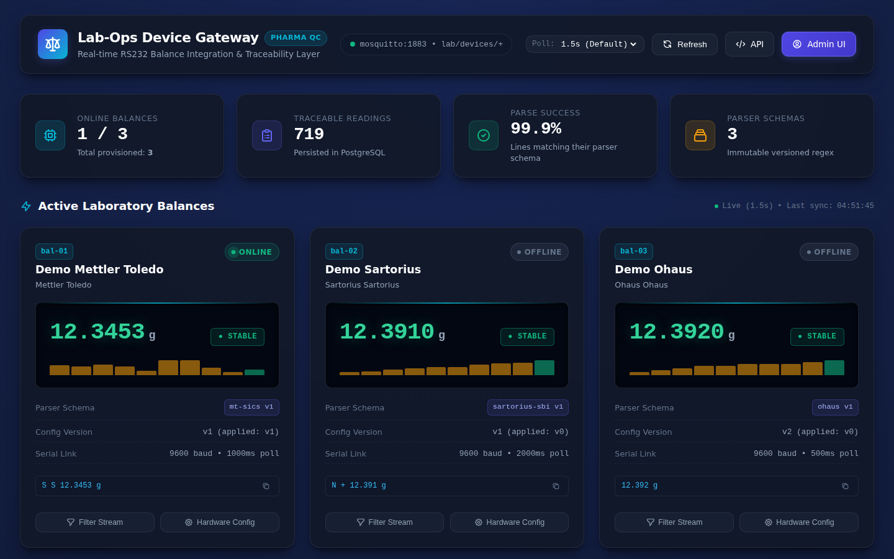
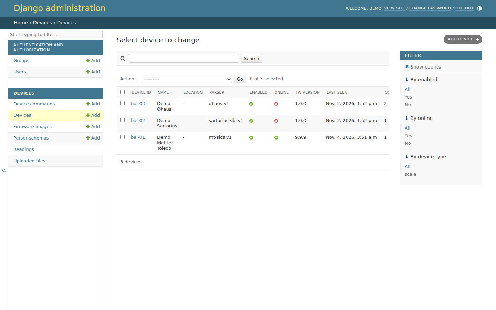
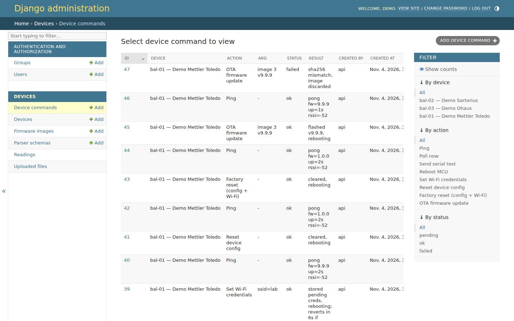
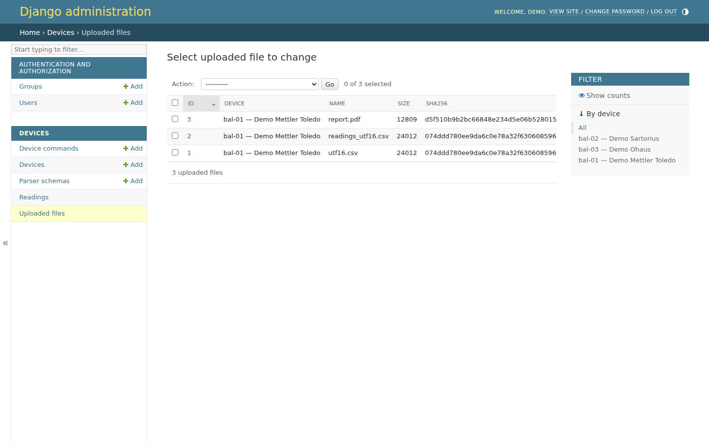
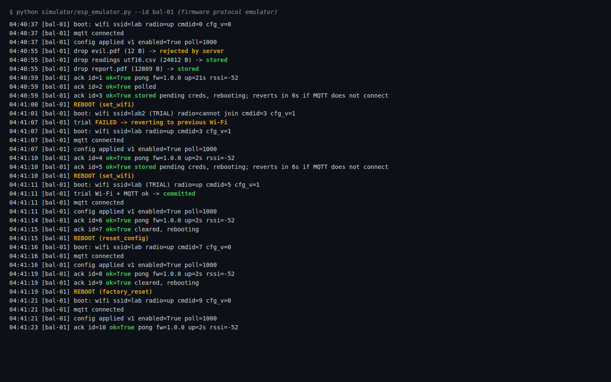
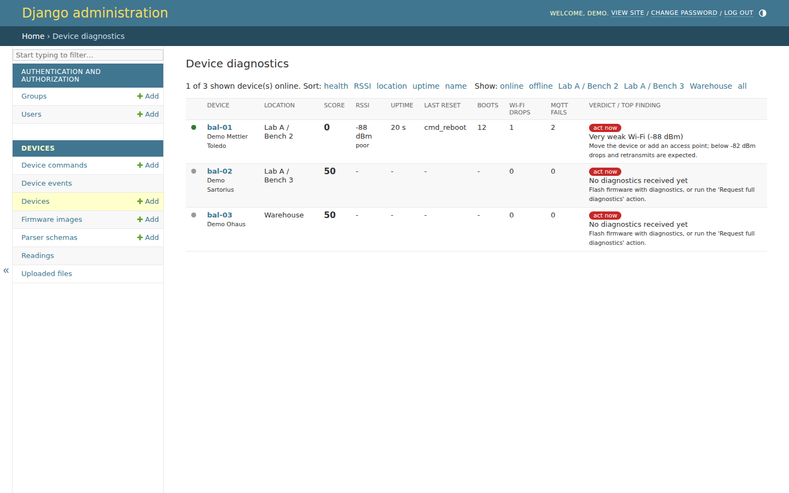
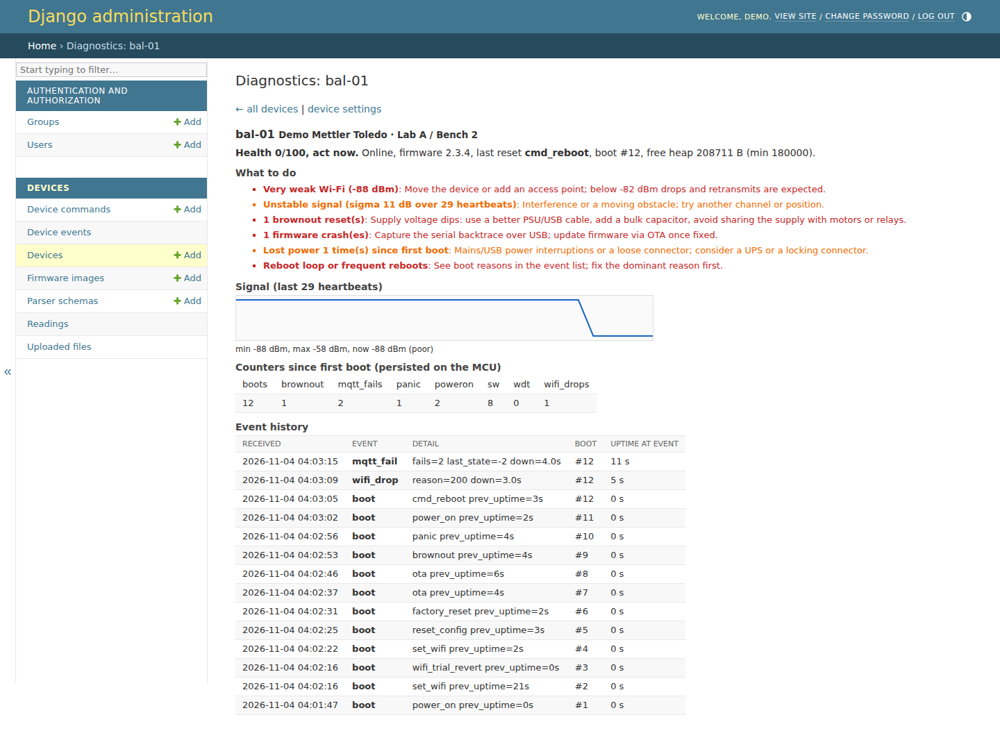

# Lab-ops device integration

An open source integration layer for balances in a pharma QC lab. ESP32-S3 firmware forwards raw RS232 lines; Django loads the device's versioned parser schema from PostgreSQL, parses and stores traceable readings, and publishes retained configuration for the device. It is the device-integration layer referenced by [lab-ops-dashboard](https://github.com/tautvydas-jocius/lab-ops-dashboard), where MES test protocols use balances.

```text
Balance RS232 -> ESP32-S3 -> MQTT -> Django listener -> parser schema from DB -> Postgres -> JSON API -> MES
                                      ^
                          Django admin -> retained MQTT config -> ESP32-S3
```

## System diagrams

- [Device integrations](docs/device-integrations.html) — data and configuration paths across the balance, firmware, MQTT, Django, PostgreSQL, and MES API. Editable source: [architecture JSON](docs/device-integrations.architecture.json).
- [Where readings stall](docs/device-stall-points.html) — current failure and exception paths in the gateway. This is a code-path map; the system does not currently record stall duration or frequency. Editable source: [lifecycle JSON](docs/device-stall-points.lifecycle.json).

## MQTT topics

Default prefix: `lab/devices` (override with `MQTT_PREFIX`).

| Topic | Direction | Retained | Payload |
|---|---|---:|---|
| `{prefix}/{device_id}/raw` | device → server | no | `{"line":"…","seq":1,"uptime_ms":1234}` |
| `{prefix}/{device_id}/config` | server → device | yes | Serial, polling, enabled, and `config_version` settings |
| `{prefix}/{device_id}/status` | device → server | yes | `{"state":"online","config_version":1,"fw":"1.0.0"}`; offline is the LWT |

## Parser schemas and traceability

Every device points to a `ParserSchema` row identified by `(name, version)`. Readings keep a foreign key to the exact schema used when they were parsed. Once readings reference a schema, changing its pattern or stability rules raises “create a new version”; create a new schema row and assign devices to it instead. Balance-specific parsing stays server-side, so adding a model requires a parser schema and no firmware change.

## Quickstart

```sh
docker compose up -d --build
# Optional simulated balances
docker compose --profile sim up -d simulator
# Create a Django admin user
docker compose exec web python manage.py createsuperuser
curl http://127.0.0.1:8011/api/devices/
curl 'http://127.0.0.1:8011/api/devices/bal-01/readings/?limit=10'
```

Admin is at `http://127.0.0.1:8011/admin/`. The API exposes `GET /api/devices/`, `GET /api/devices/{device_id}/` (including current config), and `GET /api/devices/{device_id}/readings/?limit=50&stable=1`. The MES can pull weights there. Web and MQTT host ports bind to loopback only; PostgreSQL is not published.

Settings come from environment variables: `DATABASE_URL` or `POSTGRES_*`, `MQTT_HOST`, `MQTT_PORT`, `MQTT_PREFIX`, `DEBUG`, `SECRET_KEY`, and `ALLOWED_HOSTS`.

## Remote actions (admin -> MCU)

Actions: `ping`, `poll_now`, `send_serial` (arg = text), `reboot`, `set_wifi` (arg = `{"ssid":"..","pass":".."}`), `reset_config`, `factory_reset`. Trigger them from Django admin (Devices list -> action menu, or Device commands -> Add) or the token-protected API:

```sh
export CONTROL_API_TOKEN=$(openssl rand -hex 24)   # set before docker compose up; API is disabled (403) when unset
curl -X POST -H "Authorization: Bearer $CONTROL_API_TOKEN" -d '{"action":"ping"}' http://127.0.0.1:8011/api/devices/bal-01/actions/
curl -H "Authorization: Bearer $CONTROL_API_TOKEN" http://127.0.0.1:8011/api/devices/bal-01/actions/   # history + acks
```

Server publishes `{prefix}/{id}/cmd` `{"id","action","arg","sig"}`; the MCU answers on `{prefix}/{id}/ack` `{"id","ok","result"}`. `sig` is HMAC-SHA256 over `id|action|arg` keyed with the per-device command token (Device admin page, read-only); the token never travels over MQTT. Put it in `secrets.h` as `COMMAND_TOKEN`. The firmware drops bad signatures silently and rejects non-increasing ids (replay protection, persisted in NVS). Not encrypted: use MQTT TLS and broker ACLs outside a trusted LAN.

### Wi-Fi credentials and reset (NVS)

The MCU keeps Wi-Fi in flash (NVS namespace `wifi`); `secrets.h` is only the fallback. `set_wifi` stores the new credentials as *pending*, reboots, and trials them: they become active only after MQTT connects, otherwise the MCU drops them after 45 s and reboots on the old ones, so a typo cannot strand a remote device. The password is sent signed but unencrypted over MQTT (use TLS) and is never saved in Device commands history, only the SSID. `reset_config` wipes the stored serial/poll config (the retained server config is re-applied on reconnect); `factory_reset` also wipes stored Wi-Fi, returning to `secrets.h`. Both keep the replay counter.

### WPA2-Enterprise (EAP) Wi-Fi

`set_wifi` also takes `eap_user` (and optional `eap_identity`): `{"ssid":"corp","pass":"<EAP password>","eap_user":"user@corp","eap_identity":"anon@corp"}` joins PEAP/MSCHAPv2 networks, with the same pending-then-commit rollback as above. No server certificate is validated (certificate-pinned EAP-TLS is not implemented). History records only `ssid=.. eap=<user>`.

### USB drop drive (CSV / PDF / TXT straight to the server)

With `USB_MSC_UPLOAD` defined, the ESP32-S3's native USB port (GPIO19/20) shows up as a 4 MB flash drive named `LABOPS DROP` (RAM-backed FAT12 in PSRAM; 256 KB without PSRAM; empty after every reboot). Copy a `.csv`, `.txt`, `.pdf`, `.xlsx` or `.xls` onto it; about 2 s after the host stops writing, the MCU reads the file and sends it over MQTT. Unchanged files are not re-sent; edited ones are; a missing ack triggers a retry.

Files are opaque bytes end to end: never decoded as text and never passed to a parser schema (a CSV may be UTF-16, a PDF is binary). The MCU publishes `{prefix}/{id}/file/{xfer}/meta` (JSON: name, size, chunks, sha256, HMAC `sig` keyed with the device command token) and then raw 4 KB binary chunks on `{prefix}/{id}/file/{xfer}/{seq}`. The `mqtt_listener` watcher reassembles (chunks may arrive in any order; incomplete transfers expire after 60 s), checks signature, size and SHA-256, validates the type (`.csv`/`.txt` any bytes; `.pdf` must start `%PDF`; `.xlsx` must be a zip; `.xls` must be an OLE2 file; 8 MB cap), stores it in the `media-data` volume and answers on `{prefix}/{id}/file_ack`. Browse in admin (Uploaded files) or via the API with `CONTROL_API_TOKEN`: `GET /api/devices/{id}/files/list/`, `GET /api/files/{pk}/`. Needs `ARDUINO_USB_MODE=0` (already in `platformio.ini`); pick `board_build.arduino.memory_type` to match your PSRAM. Broker note: keep `message_size_limit` at the Mosquitto default (unlimited) or at least 5 KB.

## Screenshots

Captured from a live run: the Django stack (broker, Postgres, web, `mqtt_listener`) and `simulator/esp_emulator.py` side by side in two Rex panes, driven by `simulator/e2e.py`.

**Server dashboard**: three balances, live weights, a per-reading stable/dynamic flag as reported by the balance, parser schema and config version per device. The KPI row's "Parse Success" is the share of lines that matched their parser schema (it replaced a misleading "GMP stability compliance" figure).



**Admin, device commands**: signed commands sent to the MCU and the acks it returned (ping, poll, set_wifi with rollback, resets). The Wi-Fi password is never stored, only `ssid=`.

**Admin, devices**: firmware version per device and bulk actions including OTA.





**Admin, uploaded files**: CSV, TXT, PDF and Excel files dropped on the emulated USB drive, reassembled from binary MQTT chunks by the listener. A fake PDF and an `.exe` were rejected.



**Firmware side**: the emulator log for the same run: config applied, command acks, a Wi-Fi trial that fails and reverts, a trial that commits, resets, and files from the drop drive (the fake PDF is "rejected by server"). This is the Python protocol emulator, not the C++ firmware: the firmware is not compiled here, and the FAT12 parser has only been reviewed, not run.



### Reproduce

```sh
export CONTROL_API_TOKEN=e2etoken123 && docker compose up -d --build web listener mosquitto db
TOKEN=$(docker compose exec -T web python manage.py shell -c 'from devices.models import Device; print(Device.objects.get(device_id="bal-01").command_token)')
uv run --with paho-mqtt python simulator/esp_emulator.py --id bal-01 --token "$TOKEN"   # pane 1
python simulator/e2e.py "$CONTROL_API_TOKEN"                                             # pane 2 (32 checks, including fault injection: brownout, panic, power loss, Wi-Fi drop, MQTT failure, weak RSSI)
```

### Diagnostics (Django admin)

**Admin -> Devices -> Diagnostics** ranks every device by health score with the top finding and what to do about it. Sort by health, RSSI, location, uptime or name; show online/offline or one location. The normal Devices list also has RSSI, uptime and last-reset columns with filters (online, location, last reset reason, Wi-Fi signal band). Click a device for counters, an RSSI trend, advice and its event history. Same data as JSON: `GET /api/diagnostics/?sort=rssi|uptime|location|score` (with `CONTROL_API_TOKEN`). Action **Request full diagnostics** forces a fresh report.




**What the MCU records and why reboots can be told apart.** At every boot it classifies `esp_reset_reason()`: `power_on` (supply lost, mains/USB unplugged, or first flash), `brownout` (supply dipped), `panic` (crash), `watchdog`, `reset_pin`, or a software reboot with the *reason it was asked for* (`cmd_reboot`, `ota`, `set_wifi`, `reset_config`, `factory_reset`, `wifi_trial_revert`, else `sw_unknown`). It also logs Wi-Fi drops (disconnect reason code and outage length) and MQTT failures/drops (PubSubClient state code, failed attempts, outage length).

**Persistence policy (saving vs constant MQTT updates): both, split by what changes.**
- Persistent on the MCU (NVS `diag`): counters (boots, power_on, brownout, panic, watchdog, software, Wi-Fi drops, MQTT fails) and a ring of the last 16 events, plus an uptime checkpoint every 10 minutes so the next boot knows how long the previous run lasted. Written only when something happens, so flash wear stays negligible. This survives reboots and power loss and is replayed to the server, which de-duplicates by `(device, boot id, event number)`.
- Live values (RSSI, uptime, free heap, minimum heap, channel) are not stored on the MCU: a retained heartbeat on `{prefix}/{id}/diag` every 30 s carries them and Django keeps the history (7 days, pruned by the listener). The full event list rides along only after a boot, an event, or the `diag` command.
- The MCU has no wall clock; events carry boot number and uptime and Django stamps them on arrival (so an event from before a long outage is time-stamped late).

**Health scoring** (`devices/diagnostics.py`): offline, RSSI band (good >= -67, ok, weak, poor < -82), unstable signal, brownouts (suggests PSU/cable/capacitor), crashes, watchdog resets, power losses, >3 Wi-Fi drops/day (weak signal vs AP problem), >3 MQTT failures/day while Wi-Fi is up (broker), reboot loops, low minimum heap. Thresholds are starting points, tune them to your site.

### OTA firmware updates (from the Django admin)

1. Admin -> Firmware images -> Add: upload the PlatformIO build (`firmware/.pio/build/esp32-s3-devkitc-1/firmware.bin`). Leave **version blank** for auto-versioning: Django reads it from the `LABOPS_FW=<version>` marker the firmware embeds (set per build with `-DFW_VERSION=\"1.1.0\"`), falling back to `auto-YYYYMMDD.N`. Size and SHA-256 are computed once; images are immutable. Browse versions in that admin list or via `GET /api/firmware/` (and `/api/firmware/{id}/` to download), with `CONTROL_API_TOKEN`.
2. Admin -> Devices -> tick devices -> **OTA: flash a chosen firmware version...** (pick from the version list) or **OTA: flash newest firmware image**. By API or Device commands -> Add the `ota` arg is a version (`v1.2.0` or `1.2.0`), an image id, or blank for newest.
3. The signed command carries `{image, version, size, sha256}`, so the hash is authenticated by the device token. The MCU then pulls the image itself, 4 KB at a time over MQTT (`{id}/ota_req` -> `{id}/ota/{image}/{n}`, stop-and-wait with retries), streams it to the inactive OTA partition while hashing, and only switches boot partition if the SHA-256 matches. A mismatch, timeout or write error aborts with the running firmware untouched and the reason in the command's result. On success it acks, reboots, and the new version appears in the Devices list (`fw_version`, from the MCU's status message). Set `FW_VERSION` per build (`-DFW_VERSION=\"1.1.0\"`).

**Timing.** Each command records how long it took from send to ack (`took` in admin, `took_s` in the API), and the MCU reports its own transfer time and KB/s in the result. `python simulator/ota_bench.py` measured, against the emulator on loopback: 64 KB in 0.1 s, 256 KB in 0.2 s, 1 MB in 0.9 s, 1.5 MB in 1.2 s (about 1.2 MB/s, 3.4 ms per 4 KB chunk). That is protocol and broker overhead only. On a real ESP32-S3 expect it to be dominated by the Wi-Fi round trip per chunk (stop-and-wait) plus flash erase/write, roughly 10-20 s per MB (an estimate, not measured); pipelining several chunks would cut that.

Limits: the ESP32 Arduino core is built without automatic app rollback, so a firmware that boots but is broken needs a USB or `factory_reset`-style recovery; images are authenticated by the command signature but not encrypted; the default `esp32-s3-devkitc-1` partition table has two OTA slots.

## Firmware

Install PlatformIO, copy `firmware/include/secrets.example.h` to `firmware/include/secrets.h`, set WiFi/MQTT values and `DEVICE_ID`, then build and flash from `firmware/`:

```sh
pio run
pio run --target upload
```

UART1 uses RX GPIO18 and TX GPIO17. Firmware stores the last config in NVS and uses it before MQTT returns. It forwards lines without parsing.

## License

GPL-3.0. See [LICENSE](LICENSE).
