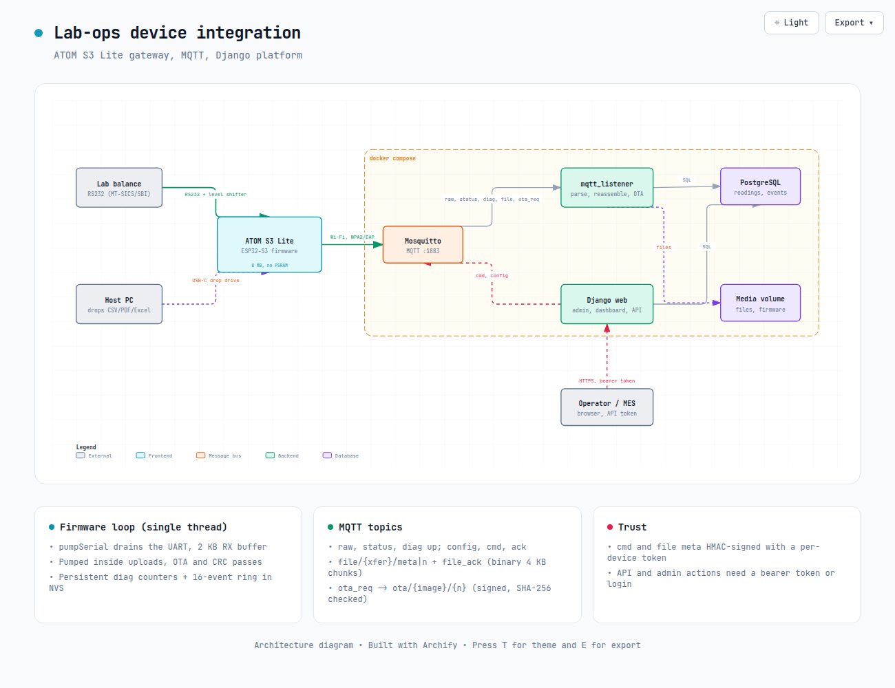
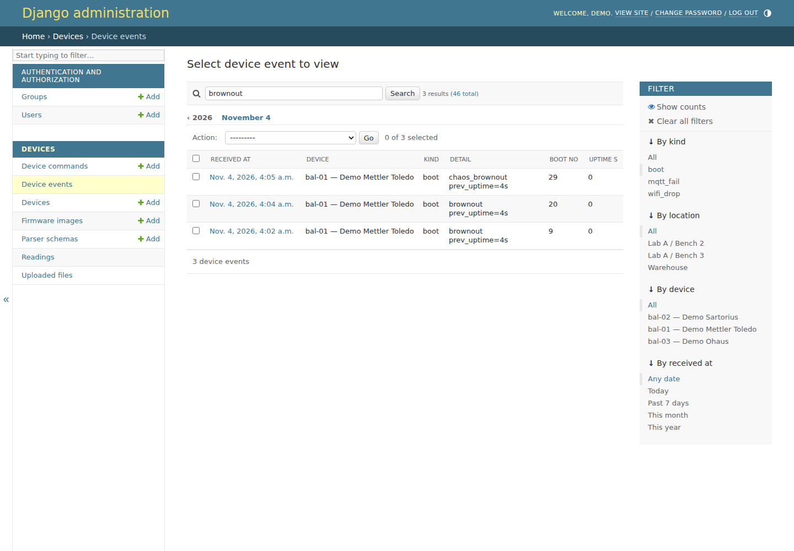

# Lab-ops device integration

Open source gateway between lab balances and a Django platform. A small ESP32-S3 board reads the balance's RS232 output and forwards raw lines over MQTT. Django parses them with versioned parser schemas stored in PostgreSQL, keeps traceable readings, and from the admin you can control the board remotely: commands, Wi-Fi credentials (including WPA2-Enterprise), OTA firmware updates, a USB flash-drive upload path for CSV/TXT/PDF/Excel files, and per-device diagnostics. It is the device-integration layer referenced by [lab-ops-dashboard](https://github.com/tautvydas-jocius/lab-ops-dashboard).



Editable diagram: [platform-architecture.html](docs/platform-architecture.html) ([JSON source](docs/platform.architecture.json)). Older diagrams: [device integrations](docs/device-integrations.html), [where readings stall](docs/device-stall-points.html).

## Contents

[Hardware example](#hardware-example-m5stack-atom-s3-lite) | [Screenshots](#screenshots) | [Quickstart](#quickstart) | [MQTT topics](#mqtt-topics) | [Parser schemas](#parser-schemas-and-traceability) | [Remote actions](#remote-actions-admin---mcu) | [Diagnostics](#diagnostics-django-admin) | [OTA](#ota-firmware-updates-from-the-django-admin) | [Firmware](#firmware) | [Testing](#testing-and-what-is-not-verified) | [Limitations](#limitations)

## Hardware example: M5Stack ATOM S3 Lite

| | |
|---|---|
| Board | [M5Stack ATOM S3 Lite](https://docs.m5stack.com/en/core/AtomS3-Lite): ESP32-S3FN8, 8 MB flash, **no PSRAM**, native USB-C, 5 V in |
| Balance serial (add-on 1) | An RS232 to 3.3 V TTL level shifter (MAX3232 type) on the Grove port: **G1 = firmware RX** (shifter TXD out), **G2 = firmware TX** (shifter RXD in), GND. Pins are build flags (`UART_RX_PIN`, `UART_TX_PIN`) |
| USB drop drive (add-on 2) | The board's own USB-C port enumerates as a flash drive (`LABOPS DROP`) when `USB_MSC_UPLOAD` is defined. Copy CSV/TXT/PDF/Excel files onto it from any PC and they are sent to Django |
| Build | `pio run -e atoms3-lite` (flash 36 % of the app slot, RAM 26 %, compiled and checked in this repo's history) |

```text
Balance DB9 --RS232--> [MAX3232 module] --3.3 V TTL--> ATOM S3 Lite Grove (G1 RX / G2 TX)
Host PC <-- USB-C (drop drive, flashing) --> ATOM S3 Lite --Wi-Fi--> MQTT broker --> Django
```

Notes and cautions:
- Power the level shifter from **3.3 V**, never 5 V, or its TTL output can overdrive G1 (the ESP32-S3 pins are not 5 V tolerant). Check your balance's DB9 pinout and whether it needs a null-modem swap; I did not wire a real balance.
- No PSRAM: the drop drive is **192 KB** (`USB_DRIVE_KB_NO_PSRAM`) instead of 4 MB, enough for CSV/TXT/small Excel, not for large PDFs. Boards with PSRAM get the 4 MB drive: **M5Stack AtomS3R** (same Atom size and Grove port, 8 MB PSRAM; `pio run -e atoms3r`, octal PSRAM assumed, switch `memory_type` to `qio_qspi` if it boot-loops) or a generic devkit (`esp32-s3-devkitc-1` env).
- `ARDUINO_USB_MODE=0` hands the USB port to the drop drive, so there is no USB serial monitor; logs go to UART0. To reflash, put the board in download mode per the M5Stack docs.
- The Grove 5 V pin and the header pins G5-G8/G38/G39 are free for other add-ons; the front button is G41 and the LED G35 (unused by the firmware).
- Wiring and pin choices here are my reading of the M5Stack docs, not tested on hardware.

## Screenshots

Captured from a live run: the Django stack (broker, Postgres, web, `mqtt_listener`) and `simulator/esp_emulator.py` (a Python emulation of the firmware protocol, not the C++ firmware) side by side in two Rex panes, driven by `simulator/e2e.py`. Fault events in the diagnostics screenshots (brownout, panic, power loss) were injected into the emulator.

**Server dashboard**: three balances, live weights, a per-reading stable/dynamic flag as reported by the balance, parser schema and config version per device. The KPI row's "Parse Success" is the share of lines that matched their parser schema (it replaced a misleading "GMP stability compliance" figure).


**Admin, device commands**: signed commands sent to the MCU and the acks it returned (ping, poll, set_wifi with rollback, resets). The Wi-Fi password is never stored, only `ssid=`.

**Admin, devices**: firmware version per device and bulk actions including OTA.


**Admin, uploaded files**: CSV, TXT, PDF and Excel files dropped on the emulated USB drive, reassembled from binary MQTT chunks by the listener. A fake PDF and an `.exe` were rejected.


**Firmware side**: the emulator log for the same run: config applied, command acks, a Wi-Fi trial that fails and reverts, a trial that commits, resets, and files from the drop drive (the fake PDF is "rejected by server"). This is the Python protocol emulator, not the C++ firmware: the firmware is not compiled here, and the FAT12 parser has only been reviewed, not run.


### Reproduce

Real firmware on Linux (stop any Python emulator first, it uses the same device id):

```sh
export CONTROL_API_TOKEN=e2etoken123 && docker compose up -d --build web listener mosquitto db
python3 simulator/sil_test.py
```

Python protocol emulator, as used for the screenshots:

```sh
export CONTROL_API_TOKEN=e2etoken123 && docker compose up -d --build web listener mosquitto db
TOKEN=$(docker compose exec -T web python manage.py shell -c 'from devices.models import Device; print(Device.objects.get(device_id="bal-01").command_token)')
uv run --with paho-mqtt python simulator/esp_emulator.py --id bal-01 --token "$TOKEN"   # pane 1
python simulator/e2e.py "$CONTROL_API_TOKEN"                                             # pane 2
```

## Quickstart

```sh
docker compose up -d --build
# Optional simulated balances
docker compose --profile sim up -d simulator
# Create a Django admin user
docker compose exec web python manage.py createsuperuser
curl http://127.0.0.1:8011/api/devices/
curl 'http://127.0.0.1:8011/api/devices/bal-01/readings/?limit=10'
```

Admin is at `http://127.0.0.1:8011/admin/`. The API exposes `GET /api/devices/`, `GET /api/devices/{device_id}/` (including current config), and `GET /api/devices/{device_id}/readings/?limit=50&stable=1`. The MES can pull weights there. Web and MQTT host ports bind to loopback only; PostgreSQL is not published.

Settings come from environment variables: `DATABASE_URL` or `POSTGRES_*`, `MQTT_HOST`, `MQTT_PORT`, `MQTT_PREFIX`, `DEBUG`, `SECRET_KEY`, and `ALLOWED_HOSTS`.

## MQTT topics

Default prefix: `lab/devices` (override with `MQTT_PREFIX`).

| Topic | Direction | Retained | Payload |
|---|---|---:|---|
| `{prefix}/{device_id}/raw` | device → server | no | `{"line":"…","seq":1,"uptime_ms":1234}` |
| `{prefix}/{device_id}/config` | server → device | yes | Serial, polling, enabled, and `config_version` settings |
| `{prefix}/{device_id}/status` | device → server | yes | `{"state":"online","config_version":1,"fw":"1.0.0"}`; offline is the LWT |
| `{prefix}/{device_id}/cmd` / `ack` | server → device / device → server | no | HMAC-signed command `{id,action,arg,sig}` and `{id,ok,result}` |
| `{prefix}/{device_id}/diag` | device → server | yes | heartbeat: uptime, RSSI, heap, counters; event ring after boot or event |
| `{prefix}/{device_id}/file/{xfer}/meta` and `/{n}` | device → server | no | signed JSON meta, then raw 4 KB binary chunks; answered on `file_ack` |
| `{prefix}/{device_id}/ota_req` / `ota/{image}/{n}` | device → server / server → device | no | OTA pull, one 4 KB chunk per request |

## Parser schemas and traceability

Every device points to a `ParserSchema` row identified by `(name, version)`. Readings keep a foreign key to the exact schema used when they were parsed. Once readings reference a schema, changing its pattern or stability rules raises “create a new version”; create a new schema row and assign devices to it instead. Balance-specific parsing stays server-side, so adding a model requires a parser schema and no firmware change.

## Remote actions (admin -> MCU)

Actions: `ping`, `poll_now`, `send_serial` (arg = text), `reboot`, `set_wifi` (arg = `{"ssid":"..","pass":".."}`), `reset_config`, `factory_reset`. Trigger them from Django admin (Devices list -> action menu, or Device commands -> Add) or the token-protected API:

```sh
export CONTROL_API_TOKEN=$(openssl rand -hex 24)   # set before docker compose up; API is disabled (403) when unset
curl -X POST -H "Authorization: Bearer $CONTROL_API_TOKEN" -d '{"action":"ping"}' http://127.0.0.1:8011/api/devices/bal-01/actions/
curl -H "Authorization: Bearer $CONTROL_API_TOKEN" http://127.0.0.1:8011/api/devices/bal-01/actions/   # history + acks
```

Server publishes `{prefix}/{id}/cmd` `{"id","action","arg","sig"}`; the MCU answers on `{prefix}/{id}/ack` `{"id","ok","result"}`. `sig` is HMAC-SHA256 over `id|action|arg` keyed with the per-device command token (Device admin page, read-only); the token never travels over MQTT. Put it in `secrets.h` as `COMMAND_TOKEN`. The firmware drops bad signatures silently and rejects non-increasing ids (replay protection, persisted in NVS). Not encrypted: use MQTT TLS and broker ACLs outside a trusted LAN.

### Wi-Fi credentials and reset (NVS)

The MCU keeps Wi-Fi in flash (NVS namespace `wifi`); `secrets.h` is only the fallback. `set_wifi` stores the new credentials as *pending*, reboots, and trials them: they become active only after MQTT connects, otherwise the MCU drops them after 45 s and reboots on the old ones, so a typo cannot strand a remote device. The password is sent signed but unencrypted over MQTT (use TLS) and is never saved in Device commands history, only the SSID. `reset_config` wipes the stored serial/poll config (the retained server config is re-applied on reconnect); `factory_reset` also wipes stored Wi-Fi, returning to `secrets.h`. Both keep the replay counter.

### WPA2-Enterprise (EAP) Wi-Fi

`set_wifi` also takes `eap_user` (and optional `eap_identity`): `{"ssid":"corp","pass":"<EAP password>","eap_user":"user@corp","eap_identity":"anon@corp"}` joins PEAP/MSCHAPv2 networks, with the same pending-then-commit rollback as above. No server certificate is validated (certificate-pinned EAP-TLS is not implemented). History records only `ssid=.. eap=<user>`.

### USB drop drive (CSV / PDF / TXT straight to the server)

With `USB_MSC_UPLOAD` defined, the ESP32-S3's native USB port (GPIO19/20) shows up as a flash drive named `LABOPS DROP` (RAM-backed FAT12: 4 MB in PSRAM, 192 KB without PSRAM, e.g. ATOM S3 Lite; empty after every reboot). Copy a `.csv`, `.txt`, `.pdf`, `.xlsx` or `.xls` onto it; about 2 s after the host stops writing, the MCU reads the file and sends it over MQTT. Unchanged files are not re-sent; edited ones are; a missing ack triggers a retry.

Files are opaque bytes end to end: never decoded as text and never passed to a parser schema (a CSV may be UTF-16, a PDF is binary). The MCU publishes `{prefix}/{id}/file/{xfer}/meta` (JSON: name, size, chunks, sha256, HMAC `sig` keyed with the device command token) and then raw 4 KB binary chunks on `{prefix}/{id}/file/{xfer}/{seq}`. The `mqtt_listener` watcher reassembles (chunks may arrive in any order; incomplete transfers expire after 60 s), checks signature, size and SHA-256, validates the type (`.csv`/`.txt` any bytes; `.pdf` must start `%PDF`; `.xlsx` must be a zip; `.xls` must be an OLE2 file; 8 MB cap), stores it in the `media-data` volume and answers on `{prefix}/{id}/file_ack`. Browse in admin (Uploaded files) or via the API with `CONTROL_API_TOKEN`: `GET /api/devices/{id}/files/list/`, `GET /api/files/{pk}/`. Needs `ARDUINO_USB_MODE=0` (already in `platformio.ini`); pick `board_build.arduino.memory_type` to match your PSRAM. Broker note: keep `message_size_limit` at the Mosquitto default (unlimited) or at least 5 KB.

### Diagnostics (Django admin)

**Admin -> Devices -> Diagnostics** shows the raw data per device (online, location, RSSI, uptime, last reset, boots, Wi-Fi drops, MQTT failures, free heap, firmware), sortable by RSSI, location, uptime or name and filterable by online/offline or location. There is no scoring or ranking. Below the table an **aggregate** (24 h / 7 d / 30 d) counts events by kind, boot reason, location, device and day, and **every number links to the raw event log** (filter by kind, location, device, date, or search any detail text). The Devices list also has RSSI, uptime and last-reset columns with filters, and a device page shows counters, an RSSI trend and its event log. JSON: `GET /api/diagnostics/?sort=rssi|uptime|location|name&days=7` (with `CONTROL_API_TOKEN`). Action **Request full diagnostics** forces a fresh report.




**What the MCU records and why reboots can be told apart.** At every boot it classifies `esp_reset_reason()`: `power_on` (supply lost, mains/USB unplugged, or first flash), `brownout` (supply dipped), `panic` (crash), `watchdog`, `reset_pin`, or a software reboot with the *reason it was asked for* (`cmd_reboot`, `ota`, `set_wifi`, `reset_config`, `factory_reset`, `wifi_trial_revert`, else `sw_unknown`). It also logs Wi-Fi drops (disconnect reason code and outage length) and MQTT failures/drops (PubSubClient state code, failed attempts, outage length).

**Persistence policy (saving vs constant MQTT updates): both, split by what changes.**
- Persistent on the MCU (NVS `diag`): counters (boots, power_on, brownout, panic, watchdog, software, Wi-Fi drops, MQTT fails) and a ring of the last 16 events, plus an uptime checkpoint every 10 minutes so the next boot knows how long the previous run lasted. Written only when something happens, so flash wear stays negligible. This survives reboots and power loss and is replayed to the server, which de-duplicates by `(device, boot id, event number)`.
- Live values (RSSI, uptime, free heap, minimum heap, channel) are not stored on the MCU: a retained heartbeat on `{prefix}/{id}/diag` every 30 s carries them and Django keeps the history (7 days, pruned by the listener). The full event list rides along only after a boot, an event, or the `diag` command.
- The MCU has no wall clock; events carry boot number and uptime and Django stamps them on arrival (so an event from before a long outage is time-stamped late).

### OTA firmware updates (from the Django admin)

1. Admin -> Firmware images -> Add: upload the PlatformIO build (`firmware/.pio/build/esp32-s3-devkitc-1/firmware.bin`). Leave **version blank** for auto-versioning: Django reads it from the `LABOPS_FW=<version>` marker the firmware embeds (set per build with `-DFW_VERSION=\"1.1.0\"`), falling back to `auto-YYYYMMDD.N`. Size and SHA-256 are computed once; images are immutable. Browse versions in that admin list or via `GET /api/firmware/` (and `/api/firmware/{id}/` to download), with `CONTROL_API_TOKEN`.
2. Admin -> Devices -> tick devices -> **OTA: flash a chosen firmware version...** (pick from the version list) or **OTA: flash newest firmware image**. By API or Device commands -> Add the `ota` arg is a version (`v1.2.0` or `1.2.0`), an image id, or blank for newest.
3. The signed command carries `{image, version, size, sha256}`, so the hash is authenticated by the device token. The MCU then pulls the image itself, 4 KB at a time over MQTT (`{id}/ota_req` -> `{id}/ota/{image}/{n}`, stop-and-wait with retries), streams it to the inactive OTA partition while hashing, and only switches boot partition if the SHA-256 matches. A mismatch, timeout or write error aborts with the running firmware untouched and the reason in the command's result. On success it acks, reboots, and the new version appears in the Devices list (`fw_version`, from the MCU's status message). Set `FW_VERSION` per build (`-DFW_VERSION=\"1.1.0\"`).

**Timing.** Each command records how long it took from send to ack (`took` in admin, `took_s` in the API), and the MCU reports its own transfer time and KB/s in the result. `python simulator/ota_bench.py` measured, against the emulator on loopback: 64 KB in 0.1 s, 256 KB in 0.2 s, 1 MB in 0.9 s, 1.5 MB in 1.2 s (about 1.2 MB/s, 3.4 ms per 4 KB chunk). That is protocol and broker overhead only. On a real ESP32-S3 expect it to be dominated by the Wi-Fi round trip per chunk (stop-and-wait) plus flash erase/write, roughly 10-20 s per MB (an estimate, not measured); pipelining several chunks would cut that.

Limits: the ESP32 Arduino core is built without automatic app rollback, so a firmware that boots but is broken needs a USB or `factory_reset`-style recovery; images are authenticated by the command signature but not encrypted; the default `esp32-s3-devkitc-1` partition table has two OTA slots.

## Firmware

Install PlatformIO, copy `firmware/include/secrets.example.h` to `firmware/include/secrets.h`, set WiFi/MQTT values and `DEVICE_ID`, then build and flash from `firmware/`:

```sh
pio run -e atoms3-lite --target upload        # M5Stack ATOM S3 Lite
pio run -e esp32-s3-devkitc-1 --target upload  # generic devkit with PSRAM
```

UART1 defaults to RX GPIO18 / TX GPIO17 (devkit) and RX G1 / TX G2 on the ATOM S3 Lite env; override with `-DUART_RX_PIN=..  -DUART_TX_PIN=..`. Set the firmware version per build with `-DFW_VERSION=\"1.1.0\"`. The loop is single-threaded: `pumpSerial()` drains the UART in the main loop and inside every blocking transfer, with a 2 KB RX buffer, so balance lines are not lost during uploads or OTA. Firmware stores the last config in NVS and uses it before MQTT returns. It forwards lines without parsing.

## Testing and what is not verified

| What | How | Result |
|---|---|---|
| Server logic | `docker compose run --rm web python manage.py test` | 15 tests pass |
| **Real firmware, software in the loop** | `CONTROL_API_TOKEN=... python3 simulator/sil_test.py` (about 5 min). The real `main.cpp` and `usb_drop.h`, with the real PubSubClient and ArduinoJson, built for Linux in the `sil` container against the real broker, listener and Django. Only the hardware is modelled (`firmware/test/sil/shim`). The USB host is `mtools` and `fsck.vfat`; OTA flashes a second real build through Django and re-executes it | 62 checks pass: config, HMAC and replay, Wi-Fi trial and rollback, EAP parameters, resets, FAT12 (8.3, long names, lowercase, fragmentation, 3 MB, 192 KB drive), OTA, reset-reason classification, outage logging, NVS usage rules |
| Protocol emulator | `simulator/e2e.py` against `simulator/esp_emulator.py`, a separate Python re-implementation of the protocol | 33 checks pass. It shares no code with the firmware, so it cannot find firmware bugs (it missed the OTA bug below) |
| Serial vs MQTT interference | `sil_test.py` sections `conc` and `nofix`: real C++, balance at 20 lines/s while a 2 MB upload and commands share the loop and MQTT link | With the fix: 235 of 235 lines stored, sequence contiguous, 0 lost. Negative control with `pumpSerial()` and the 2 KB buffer removed: 21 of 231 lines lost, so the test can fail. Not covered: lines during an OTA transfer. Linux timing, not ESP32 timing |
| Firmware compile | `pio run -e esp32-s3-devkitc-1`, `-e atoms3-lite`, `-e atoms3r` | all build (about 1.2 MB flash, 26 % RAM) |
| Firmware in QEMU | `firmware/tools/qemu_smoke.sh` (Espressif QEMU, `esp32s3` machine) | ROM, bootloader and IDF startup run; then an assert in IDF `init_flash` (before `setup()`) stops it, with or without PSRAM, DIO or QIO. Arduino's prebuilt libs do not match QEMU's flash model, so our code was never reached. Not a firmware result either way |
| OTA speed | `simulator/ota_bench.py` against the emulator over loopback | about 1.2 MB/s; real Wi-Fi will be much slower |

**Bugs the software-in-the-loop test found that the emulator could not:** OTA never worked (the firmware subscribed to `ota//#`, a double slash, so no chunk ever arrived); lowercase 8.3 file names arrived uppercased (VFAT case flags ignored); the drive had no volume label entry (`fsck.vfat` complained). All fixed.

**Not verified:** the firmware has never run on an ESP32-S3. The shim models the radio, flash and USB, so these remain untested: real Wi-Fi and EAP authentication, USB enumeration on a real PC, real flash writes and the boot-partition switch, real `esp_reset_reason()` values, real RSSI and memory use, and timing under load. Espressif's QEMU does not emulate the S3's Wi-Fi and the Arduino build stops in IDF startup there (see the table). Next step: flash an AtomS3R and run `e2e.py`-style checks against it.

## Limitations

- MQTT is plaintext and the broker allows anonymous clients (compose default): use TLS and broker ACLs outside a trusted LAN. Commands and files are signed, not encrypted.
- EAP: PEAP/MSCHAPv2 only, server certificate not validated.
- No automatic OTA rollback in this Arduino build.
- The MCU has no wall clock; event times are stamped on arrival.
- The drop drive is RAM-backed and empty after every reboot.

## License

GPL-3.0. See [LICENSE](LICENSE).
